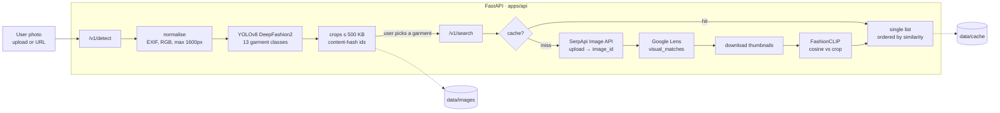

# Vibear

AI agent that helps you find the clothes you saw on Instagram Reels, TikTok, Pinterest or any other social media.

Snap an outfit, get shoppable matches. Vibear finds each garment in a photo, lets the user pick one, and returns a single list of products ordered by visual similarity.

## Architecture (MVP)



Design decisions:

- **Detect and search are two calls.** Detection is local and free; search spends SerpApi quota. The user picks one garment, so a photo with three garments costs one search, not three.
- **No public image hosting.** Crops go to SerpApi's Image API (`POST /image`, max 500 KB, id valid for 10 minutes), so there is no bucket or tunnel to run.
- **CLIP re-ranks, it doesn't search.** Google Lens finds candidates; FashionCLIP orders them by similarity to the crop. The score is returned so the UI can show it.
- **Content-addressed crops + result cache.** The same crop always gets the same id, and its results are cached for 72 h.
- **One service.** No Postgres, Redis or vector DB until there is a catalog to store (milestone 2).

## API

| Method | Path | What it does |
|---|---|---|
| `GET` | `/health` | `{"status": "ok", "search_enabled": bool}` |
| `POST` | `/v1/detect` | multipart `file` **or** form field `image_url` → garments with `crop_id`, `label`, `confidence`, `box`, `crop_url` |
| `POST` | `/v1/search` | `{"crop_id": "...", "limit": 24}` → matches with `title`, `link`, `source`, `thumbnail`, `price`, `similarity` |
| `GET` | `/media/{crop_id}.jpg` | stored crops |

Interactive docs at `http://localhost:8000/docs`.

## Run locally

Python 3.11+. Keep the virtualenv **outside OneDrive** (torch is ~1 GB of small files).

```bash
cd apps/api
python -m venv C:/dev/venvs/vibear          # any path outside OneDrive
C:/dev/venvs/vibear/Scripts/activate        # Linux/macOS: source <venv>/bin/activate
pip install -r requirements-dev.txt
cp .env.example .env                        # add SERPAPI_API_KEY
uvicorn app.main:create_app --factory --reload
```

The first start downloads the YOLO and FashionCLIP weights (~600 MB) into the Hugging Face cache. Measured on CPU: detection ~0.7 s per photo once warm (the first request pays a ~7 s warm-up), CLIP ~3.5 s for 40 thumbnails.

```bash
curl -F "file=@outfit.jpg" localhost:8000/v1/detect
curl -H "Content-Type: application/json" -d '{"crop_id":"<id>"}' localhost:8000/v1/search
```

## Run with Docker

```bash
cp apps/api/.env.example apps/api/.env
docker compose up --build
```

The image installs CPU-only torch. Weights and data persist in named volumes.

## Tests

```bash
cd apps/api && pytest
```

Models and SerpApi are replaced by fakes, so tests run offline, without torch or a key.

## Costs and limits

- **SerpApi free plan:** a small monthly quota (third-party guides report 250 searches/month; check your dashboard). Only `/v1/search` cache misses spend it.
- **Models:** run on CPU, no per-request cost.
- **Licenses (before any commercial use):** Ultralytics YOLO is AGPL-3.0. The detector weights were trained on DeepFashion2, whose repository states no commercial licence. Both are fine for a portfolio MVP and need replacing or licensing before monetising.

## Roadmap

1. **MVP (now):** detect → pick → search → ranked list. Next: Next.js + Tailwind front end in `apps/web`.
2. **Own catalog:** scrape or ingest product feeds, embed with the same CLIP model, store in Postgres + pgvector, blend with Lens results.
3. **Personalisation:** saved items and likes, a style profile, text refinement ("same but in black") with CLIP text embeddings, then an LLM layer once there is budget.
