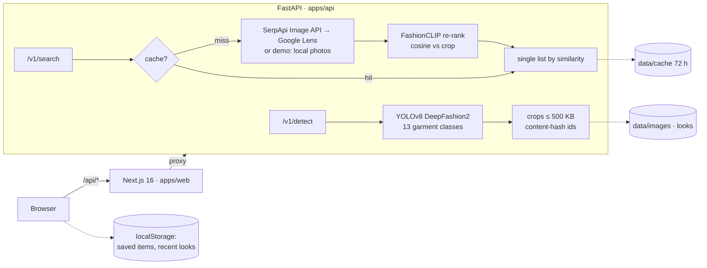

# Vibear

AI agent that helps you find the clothes you saw on Instagram Reels, TikTok, Pinterest or any other social media.

Snap an outfit, get shoppable matches. Vibear finds each garment in a photo, lets you pick one, and returns a single list of products ordered by visual similarity. Save the ones you like to a moodboard.

## Quick start

Requirements: Node 20.9+, Python 3.11+ (tested on 3.14), ~2 GB of disk for torch and the models.

```bash
npm run setup   # npm packages, the API's Python venv, apps/api/.env, the test browser
npm run dev     # API on :8000 + web on :3000, both reload on save
```

Open http://localhost:3000: the landing tells the story, and **Empezá a escanear** takes you to the scanner (`/scan`).

- **No SerpApi key yet?** The default `.env` turns on demo search: a bundled catalog of ~50 garment crops from freely licensed photos (`apps/api/app/demo_catalog`) plays the role of products, so the very first search already returns similar clothes. A banner says so.
- **Real products:** get a free key at [serpapi.com](https://serpapi.com), set `SERPAPI_API_KEY` in `apps/api/.env` and restart `npm run dev`.
- The first start downloads the YOLO and FashionCLIP weights (~600 MB) and takes a few minutes. After that the API starts in ~20 s.
- The venv lives outside the repo (`~/.venvs/vibear`, or `$VIBEAR_VENV`), because torch is ~1 GB of small files and cloud-synced folders handle that badly. An existing `C:\dev\venvs\vibear` is picked up too.

## Commands

| Command | What it does |
|---|---|
| `npm run setup` | One-time setup (safe to re-run) |
| `npm run dev` | API + web with reload |
| `npm run check` | API tests, typecheck, lint (zero warnings), production build, Playwright end-to-end and layout tests |
| `npm run test:api` | API tests only (offline, fakes instead of models) |
| `docker compose up --build` | The full stack in containers (web :3000, API :8000) |

## Architecture



Design decisions:

- **Detect and search are two calls.** Detection is local and free; a search spends SerpApi quota. You pick one garment, so a photo with three garments costs one search, not three.
- **No public image hosting.** Crops go to SerpApi's Image API (`POST /image`, max 500 KB, id valid 10 minutes).
- **CLIP re-ranks, it doesn't search.** Google Lens finds candidates; FashionCLIP orders them by similarity to the crop, and the score is shown.
- **Content-addressed images + cache.** The same crop always gets the same id, and its results are cached for 72 h. Looks are stored, so `/look/<id>` survives a refresh.
- **One origin.** The browser only talks to Next; `/api/*` is proxied to FastAPI (no CORS, no API URL in the client).
- **"Buscar en mi zona" without paid maps.** Shops come from OpenStreetMap through Nominatim (free, one request per search, cached 10 min). Google Maps is used for what is free: you can paste a Google Maps link as your location, and every shop opens Google Maps directions.
- **No database yet.** Postgres + pgvector arrive with the own catalog (milestone 2).

## Project structure

```
apps/
  api/                  FastAPI service (Python)
    app/main.py         routes and app factory
    app/ml/             YOLO detector, CLIP embedder
    app/lens.py         SerpApi client · app/demo.py offline stand-in
    app/rerank.py       thumbnails + CLIP ranking
    tests/              pytest, offline
  web/                  Next.js 16 + Tailwind 4 (TypeScript)
    src/app/            routes: / (landing), /scan, /look/[id], /saved, /creditos
    src/components/     UI · landing/ (the story) · motion/ (kinetic type, loops, pause)
    src/lib/            API client, masonry layout, storage, labels, landing data (generated)
    public/landing/     landing photos (WebP, freely licensed, credited on /creditos)
    e2e/                Playwright: flows, motion (pause, reduced motion), layout at 4 widths
  api/scripts/build_landing_assets.py   rebuilds the landing photos and explainer data
scripts/                setup, API runner (cross-platform Node)
.claude/skills/         vibear-design (design system) and vibear-motion (motion graphics)
```

## API

| Method | Path | What it does |
|---|---|---|
| `GET` | `/health` | `{"status": "ok", "search": "serpapi" \| "demo" \| "off"}` |
| `POST` | `/v1/detect` | multipart `file` **or** form field `image_url` → garments with `crop_id`, `label`, `confidence`, `box`, `crop_url` |
| `GET` | `/v1/looks/{image_id}` | a look detected earlier |
| `POST` | `/v1/search` | `{"crop_id": "...", "limit": 48}` → matches with `title`, `link`, `source`, `thumbnail` (+ size), `price`, `similarity` |
| `GET` | `/v1/places/geocode?q=` | coordinates for an address, a neighbourhood, `lat, lng` or a Google Maps link (short `maps.app.goo.gl` links are resolved through Google hosts only) |
| `GET` | `/v1/places/nearby?lat=&lng=&radius=&brands=` | clothing shops nearby from OpenStreetMap (Nominatim), the ones selling a brand from the results first |
| `GET` | `/media/{id}.jpg` | stored photos and crops |

Interactive docs at http://localhost:8000/docs.

## Design and motion

Editorial fashion minimalism crossed with a Pinterest-style discovery grid: an oversized didone wordmark, monochrome sharp chrome, uppercase micro labels, and a ranked masonry of rounded image cards with save-to-board. The rules (tokens, components, copy voice, accessibility, the checks to run) live in [`.claude/skills/vibear-design/SKILL.md`](.claude/skills/vibear-design/SKILL.md).

The landing tells the story with motion graphics: a kinetic headline, Pinterest-style photo columns drifting in opposite directions, lines that light up as you scroll, marquee carousels, and a 10-second explainer of the scan built on real model output (YOLO boxes and FashionCLIP similarities on a real photo). It is all CSS (transform and opacity, scroll-driven timelines), pauses off-screen, has a visible "Pausar movimiento" control and turns static with reduced motion. Rules in [`.claude/skills/vibear-motion/SKILL.md`](.claude/skills/vibear-motion/SKILL.md). Claude Code loads both skills when you change the front end.

The landing photos are freely licensed photos from Wikimedia Commons (mostly CC0 imports from Unsplash, plus CC BY / CC BY-SA), balanced between menswear and womenswear, with flat-lay boards composed from product cutouts. They are credited on `/creditos`. To change them, edit the lists in `apps/api/scripts/build_landing_assets.py` and run it with the API's venv: it also rebuilds the demo catalog and the explainer from real YOLO and FashionCLIP output.

## Costs and limits

- **SerpApi free plan:** a small monthly quota (third-party guides report 250 searches/month; check your dashboard). Only search cache misses spend it.
- **CPU timings** (measured): detection ~1 s per photo, a search ~5 s for 40 candidates (mostly CLIP), first API start ~20 s.
- **Licenses (before any commercial use):** Ultralytics YOLO is AGPL-3.0, and the detector weights were trained on DeepFashion2, whose repository states no commercial licence. Fine for a portfolio MVP; replace or license them before monetising.

## Roadmap

1. **MVP (done):** landing with motion storytelling, detect → pick → search → ranked list → moodboard → shops nearby, demo mode, Docker.
2. **Own catalog:** ingest product feeds, embed with the same CLIP model, store in Postgres + pgvector, blend with Lens results.
3. **Personalisation:** accounts and synced boards, a style profile, text refinement ("same but in black") with CLIP text embeddings, then an LLM layer once there is budget.
