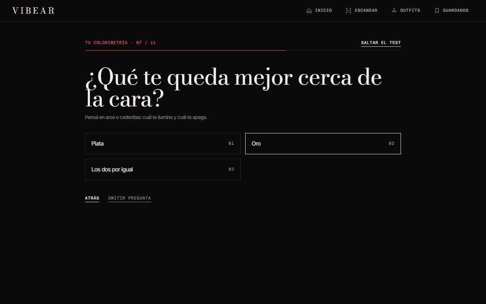
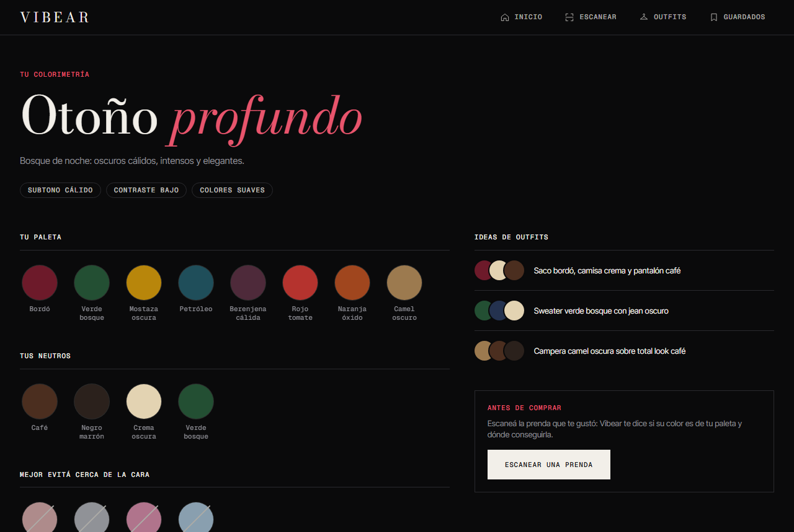
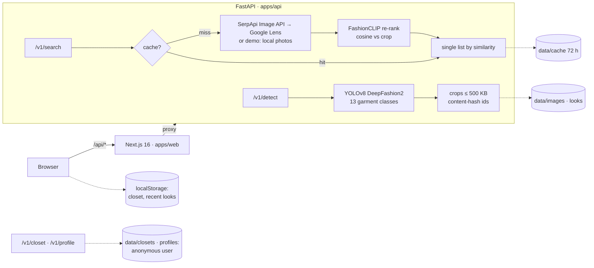

<div align="center">

# V I B E A R

**Lo viste. *Encontralo.***

Your aesthetic advisor: find the clothes you saw on Reels, TikTok or Pinterest, learn which colours suit you, and shop the week's outfits and fragrances, in Argentine shops and in pesos.

     

</div>

---

## What it does

| | |
|---|---|
| **Scan any outfit** | Upload a screenshot: YOLO finds every garment (clothes, shoes, bags, glasses, hats), names it in Spanish ("Buzo polo de corderito negro", "símil Polo Ralph Lauren") and finds it in Argentine shops, ranked by look **and colour** with FashionCLIP. |
| **Your colours** | A one-minute style test with colour analysis: your season (12-season system), palette, neutrals, colours to avoid, metals and outfit ideas, as a card you can download. After it, every scanned garment tells you whether it suits your palette. |
| **Outfits of the week** | Three looks for women and three for men every week, each garment with where to buy it. Yours first, marked *Para vos*. |
| **Fitting room** | A dress-up game with your own photo and clothes: garments cut out and placed by body keypoints, for men and women. |
| **Perfumery** | A scroll film of three fragrance covers, the day's best price across Argentine perfume shops, a twelve-bottle catalogue and a direct WhatsApp line to the supplier. |
| **Your closet, without an account** | Save products and your style profile; an anonymous id keeps them when you come back, even after Safari wipes site data. |
| **Pinterest inspo** | Your and your friends' boards, through Pinterest's official embed. |

Built like a premium product: Bodoni editorial type on a black stage, an Apple-style scroll story in the hero, tab switches that slide and morph in a fifth of a second, motion that pauses off-screen and respects reduced motion, and zero long tasks while you scroll.

### Screenshots

| The style test | Your palette |
|---|---|
|  |  |

> More to add: a GIF of the hero's scroll story and of the perfume film (`docs/screenshots/`). The landing's photos are freely licensed and credited on `/creditos`; never commit screenshots that show Pinterest pins or shop photos: they belong to their authors.

## Quick start

Requirements: Node 20.9+, Python 3.11+ (tested on 3.14), ~2 GB of disk for torch and the models.

```bash
npm run setup   # npm packages, the API's Python venv, apps/api/.env, the test browser
npm run dev     # API on :8000 + web on :3000, both reload on save
```

Open http://localhost:3000: the landing tells the story, and **Empezá a escanear** takes you to the scanner (`/scan`).

- **No SerpApi key yet?** The default `.env` turns on demo search: a bundled catalog of ~50 garment crops from freely licensed photos (`apps/api/app/demo_catalog`) plays the role of products, so the very first search already returns similar clothes. A banner says so.
- **Real products:** get a free key at [serpapi.com](https://serpapi.com), set `SERPAPI_API_KEY` in `apps/api/.env` and restart `npm run dev`.
- The first start downloads the YOLO and FashionCLIP weights (~600 MB) and takes a few minutes. After that the API starts in ~20 s.
- The venv lives outside the repo (`~/.venvs/vibear`, or `$VIBEAR_VENV`), because torch is ~1 GB of small files and cloud-synced folders handle that badly. An existing `C:\dev\venvs\vibear` is picked up too.

## Commands

| Command | What it does |
|---|---|
| `npm run setup` | One-time setup (safe to re-run) |
| `npm run dev` | API + web with reload; it also opens the main pages once at start, so the first tab switch doesn't wait for Next to compile them |
| `npm run preview` | Production build of the web + API: how fast the site really is (`next dev` compiles on demand and is slower by design) |
| `npm run check` | API tests, typecheck, lint (zero warnings), production build, Playwright end-to-end and layout tests |
| `npm run test:api` | API tests only (offline, fakes instead of models) |
| `npm run photos` | Build the landing from your own photos in `apps/web/local-photos/` (see below) |
| `docker compose up --build` | The full stack in containers (web :3000, API :8000) |

## Environment variables

| Where | Variable | Default | What it does |
|---|---|---|---|
| `apps/api/.env` | `SERPAPI_API_KEY` | empty | Google Lens through SerpApi for real product search ([free key](https://serpapi.com)) |
| | `DEMO_SEARCH` | `true` | Without a key, rank the bundled demo catalog instead (labelled as demo) |
| | `SERPAPI_COUNTRY` / `SERPAPI_HL` | `ar` / `es-419` | Ask Google from Argentina, in Spanish |
| | `SEARCH_CACHE_HOURS` | `72` | How long a search result is reused (only cache misses spend quota) |
| | `CLIP_MODEL`, `YOLO_REPO`, `YOLO_FILE`, `ACCESSORY_REPO`, `POSE_REPO`, `POSE_FILE` | see `.env.example` | The models, from the Hugging Face Hub |
| | `DETECT_CONFIDENCE` | `0.35` | YOLO's confidence threshold |
| | `DATA_DIR` | `data` | Photos, looks, cache, anonymous closets and profiles |
| | `MAX_UPLOAD_MB` / `CORS_ORIGINS` | `10` / localhost:3000 | Upload size and allowed origins |
| `apps/web/.env.local` | `NEXT_PUBLIC_PINTEREST_BOARD` | empty | Boards for "Inspo de tableros", comma-separated |
| | `NEXT_PUBLIC_PINTEREST_PINS` | empty | Single pins, comma-separated |
| build / Docker | `API_URL` | `http://127.0.0.1:8000` | Where Next proxies `/api/*` (read at build time) |

Both `.env.example` files are the reference; `.env` and `.env.local` are never committed.

## Architecture



Design decisions:

- **Detect and search are two calls.** Detection is local and free; a search spends SerpApi quota. You pick one garment, so a photo with three garments costs one search, not three.
- **No public image hosting.** Crops go to SerpApi's Image API (`POST /image`, max 500 KB, id valid 10 minutes).
- **Argentina only.** Every shop Vibear shows sells in Argentina, in pesos. Google Lens is asked from Argentina, and a result only stays when its link is an Argentine shop: an `.ar` domain, a Tiendanube store (`*.mitiendanube.com`) or a global brand's Argentine site (`zara.com/ar/es/...`). Shops abroad and import services are dropped (`is_argentine_shop` in `app/lens.py`).
- **CLIP re-ranks, it doesn't search.** Google Lens finds candidates; FashionCLIP orders them by similarity to the crop, and the score is shown.
- **Look and colour.** CLIP sees cut, texture and style, but two sweaters of the same cut score almost the same in any colour. Each picture also gets a colour signature (the median CIELAB colour of its middle, without a studio's white background, `app/colorsig.py`), and the similarity moves up to 0.05 either way by how close the colours are (`COLOR_WEIGHT` in `app/rerank.py`). Calibrated on the demo catalog: the top results' colour came 15% closer for a 0.004 loss in CLIP similarity.
- **Only results that really look alike.** Each result's picture is classified zero-shot (top, bottom, dress, shoes, bag, accessory) and dropped when it is clearly another kind of thing than the scanned garment, and results under a FashionCLIP similarity of 0.55 are dropped too. Calibrated on the demo catalog: for a trousers query, jackets and sweaters CLIP still rated 0.63-0.65 used to sit among the real trousers; now they go.
- **Garments are named for what they are.** YOLO only knows 13 classes ("long sleeved shirt"), so each garment is also named in Spanish ("Buzo polo de corderito negro"): the type and material by FashionCLIP zero-shot over a catalogue of garments, the colour from the garment's own pixels (YOLO's segmentation mask), classified by hue first so shadows don't turn cream into grey. The brand comes from what the search results agree on (also brands we don't know, when several titles start with the same word), or, without a search, from the photo only when the model is very sure.
- **Shoes and accessories too.** YOLO DeepFashion2 only knows clothes, so a second detector, YOLOS fine-tuned on Fashionpedia (`valentinafeve/yolos-fashionpedia`, MIT), finds shoes, bags, glasses, hats, belts, watches, scarves and headbands (`app/ml/accessories.py`). The two shoes of a pair become one item, and boxes inside boxes are dropped. FashionCLIP names them ("Mocasines negros", "Botas altas marrones", "Bandolera marrón", "Gorra marrón"). When the exact type isn't clear (loafers half hidden under trousers), it says "Zapatos negros" rather than guess.
- **No brand? Then "símil".** When the brand isn't known but the design is a brand's signature, the garment is labelled the way Argentine shops list a lookalike: a polo shirt is "símil Polo Ralph Lauren", jeans "símil Levi's", a puffer "símil The North Face", a sherpa polo "símil Stüssy" (`ICONIC` in `describe.py`). It comes from the type, not from guessing the label: below 0.7 the zero-shot brand is noise (it called a black sherpa polo "Converse").
- **Content-addressed images + cache.** The same crop always gets the same id, and its results are cached for 72 h. Looks are stored, so `/look/<id>` survives a refresh.
- **One origin.** The browser only talks to Next; `/api/*` is proxied to FastAPI (no CORS, no API URL in the client).
- **A closet without accounts.** Saved products live in the browser and are backed up in the API under a random id kept in an HttpOnly cookie (see below).
- **CLIP vectors are cached** by thumbnail URL (LRU, 4096 entries): the same products come back across searches, and the demo catalog is embedded in the background at startup.
- **Heavy work off the main thread.** Perfume photos are cut out of their white background in a Web Worker (`lib/cutout.worker.ts`, OffscreenCanvas): on the main thread a 1400px bottle took ~100 ms on a laptop and ~600 ms on a phone, right as the section scrolled in.
- **"Buscar en mi zona" without paid maps.** Shops come from OpenStreetMap through Nominatim (free, one request per search, cached 10 min). Google Maps is used for what is free: you can paste a Google Maps link as your location, and every shop opens Google Maps directions.
- **No database yet.** Postgres + pgvector arrive with the own catalog (milestone 2).

## Project structure

```
apps/
  api/                  FastAPI service (Python)
    app/main.py         routes and app factory
    app/ml/             YOLO detector, CLIP embedder
    app/lens.py         SerpApi client · app/demo.py offline stand-in
    app/rerank.py       thumbnails + CLIP ranking (category filter, similarity floor, colour, vector cache)
    app/colorsig.py     colour signatures (CIELAB) for ranking and garment colour names
    app/ml/describe.py  garment names, colours, styles and brands
    app/prices.py       perfumery: catalogue and prices from Argentine shops (+ SerpApi Google Shopping)
    app/tryon.py        fitting room: garments cut out of their photos · app/ml/pose.py body keypoints
    tests/              pytest, offline
  web/                  Next.js 16 + Tailwind 4 (TypeScript)
    src/app/            routes: / (landing), /scan, /look/[id], /outfits (fitting room), /estilo (style test), /saved, /creditos, and the 404
    src/components/     UI · landing/ (the story) · motion/ (kinetic type, loops, pause)
    src/components/style/  the style test, its result, and its entry points around the site
    src/lib/            API client, masonry layout, storage, profile, colorimetry, style, cut-out (+ worker), landing data (generated)
    public/landing/     landing photos (WebP, freely licensed, credited on /creditos)
    e2e/                Playwright: flows, motion (pause, reduced motion), layout at 4 widths
  api/scripts/build_landing_assets.py   rebuilds the landing photos and explainer data
scripts/                setup, API runner (cross-platform Node)
.claude/skills/         vibear-design (design system) and vibear-motion (motion graphics)
```

## API

| Method | Path | What it does |
|---|---|---|
| `GET` | `/health` | `{"status": "ok", "search": "serpapi" \| "demo" \| "off"}` |
| `POST` | `/v1/detect` | multipart `file` **or** form field `image_url` → garments with `crop_id`, `label`, `confidence`, `box`, `crop_url`, and `name` / `kind` / `brand` / `similar` / `color` when the model can tell |
| `GET` | `/v1/looks/{image_id}` | a look detected earlier |
| `POST` | `/v1/search` | `{"crop_id": "...", "limit": 48, "label": "trousers"}` → matches with `title`, `link`, `source`, `thumbnail` (+ size), `price`, `similarity`, plus the `brand` most results agree on. `label` lets it drop results of another kind |
| `GET` | `/v1/fragrances` | the perfumery catalogue: every fragrance with its offers at Argentine shops (cheapest first) and the shop's photo |
| `GET` | `/v1/fragrances/{id}/prices` | one fragrance, shop by shop, Google Shopping included with a SerpApi key (see below) |
| `POST` | `/v1/tryon/body` | multipart `file` → a full-body photo's keypoints (shoulders, hips, knees, ankles) as fractions; 422 if it isn't a full body |
| `POST` | `/v1/tryon/garments` | multipart `file` **or** `image_url` → every garment in the photo cut out (WebP data URL, transparent around it) with its slot (`top`, `outer`, `bottom`, `dress`), name and box, plus the wearer's pose when there is one. Nothing is stored |
| `GET` | `/v1/places/geocode?q=` | coordinates for an address, a neighbourhood, `lat, lng` or a Google Maps link (short `maps.app.goo.gl` links are resolved through Google hosts only) |
| `GET` | `/v1/places/nearby?lat=&lng=&radius=&brands=` | clothing shops nearby from OpenStreetMap (Nominatim), the ones selling a brand from the results first |
| `GET` / `PUT` | `/v1/closet` | this browser's saved products: `{"items": [...], "updated_at": <epoch ms>}`; the newest copy wins |
| `GET` / `PUT` | `/v1/profile` | this browser's style profile: `{"user": "<uuid>", "status": "new" \| "done" \| "skipped", "style": {...}, "color": {"season": "otono-suave", ...}, "updated_at": <epoch ms>}`, same anonymous cookie as the closet; short keys only |
| `GET` | `/media/{id}.jpg` | stored photos and crops |

Interactive docs at http://localhost:8000/docs.

## The anonymous user: closet (*placard*) and profile

Vibear knows who it is talking to without an account. On the first visit the browser makes up an id (a UUID, `lib/profile.ts`); saved products and the style profile are kept in the browser and backed up in the API under one anonymous HttpOnly cookie, so they are there every time you come back, even after Safari's purge of site data for sites not opened in 7 days. The server only hears about a visitor once they save something, or answer or skip the style test, so a passing bot creates nothing. Administration: [ADMIN_GUIDE.md](ADMIN_GUIDE.md).

Saved products stay in the browser (localStorage) and the API keeps an anonymous copy:

- **No login.** The first save gets a random id (`secrets.token_hex(16)`) in an HttpOnly, SameSite=Lax cookie `vibear_closet`, valid 400 days and renewed on each visit. Cookies set by the server are not script-writable storage, so Safari's 7-day cap doesn't apply to them. On load, the browser compares its copy with the API's and keeps the newest (`updated_at`).
- **Limits:** the closet is per browser (a phone and a laptop have different ones), and clearing the browser's data or using a private window loses it. A login would be the next step to share it across devices; the API's id can be attached to an account then.
- **Little to administer.** Each closet is a JSON file in `apps/api/data/closets/<id>.json`, and its profile `apps/api/data/profiles/<id>.json` (with Docker, in the `api-data` volume). They hold product links, thumbnails and the test's answers as short keys: no names, emails or photos. See [ADMIN_GUIDE.md](ADMIN_GUIDE.md).

## Your style: the style test and colour analysis

`/estilo` is a one-minute test, one question per screen, mobile-first; every question can be skipped, and so can the whole test.

1. **Style:** who you dress (women, men, both), the styles you like (picked on real looks of each style: clean/minimal, old money, streetwear, casual, university, tenis, pilates), your days, what you want from your clothes and your budget per garment in pesos.
2. **Colour analysis:** six questions in front of a mirror (wrist veins, gold or silver, the sun, natural hair, eyes, skin). They give undertone (warm, cool, neutral), depth, contrast and chroma, and one of the **12 seasons** (Primavera clara/cálida/brillante, Verano claro/frío/suave, Otoño suave/cálido/profundo, Invierno profundo/frío/brillante). Deterministic: the same answers always give the same season (`lib/colorimetry.ts`). It is a guide, not a draping session with a colourist.
3. **The result:** the season with its palette, neutrals, colours to avoid near the face, metals and three outfit ideas; your styles and a tip per goal; real looks for you; a 1080×1350 card to download and share.

What it changes around the site: the week's outfits put your gender and styles first (*Para vos*); a scanned garment says "Va con tu paleta" or "Fuera de tu paleta" (the API returns each garment's colour name); the closet shows your palette; the landing's wine section and the hero show your season instead of the invitation; the 404 offers the test first.

## Outfits: the fitting room

The **Outfits** tab (`/outfits`) is a dress-up game with your own clothes, for men and women alike:

1. Upload a full-body photo of yourself. YOLO11 pose (`Ultralytics/YOLO11`, `yolo11n-pose.pt`) finds your shoulders, hips, knees and ankles.
2. Add garments: a photo of one hanging or on the floor, a product shot on white, or a photo of yourself in a full outfit. Every garment comes out separately, cut along YOLO's segmentation mask (what a top covers is taken out of the trousers under it). A product shot where YOLO sees nothing is cut from its white background. Your saved products (*placard*) can go in too.
3. Tap a garment to wear it; a dress replaces a top and trousers. Each piece is placed by keypoints. When it came off someone, it is scaled by the same body parts on both photos (shoulder width, torso, hips: the median) and pinned where it sat on them. A flat lay is sized by rule of thumb. Drag it, resize it, move it with the arrow keys, take it off, download the look.

It's a 2D paper doll, not a generated photo: instant, free, and private. The API reads the photos in memory and keeps nothing; the browser keeps them in IndexedDB, on this device only. A realistic try-on needs a diffusion model (IDM-VTON, CatVTON) on a GPU, which this setup doesn't have.

## Outfits of the week and the perfumery

- **Outfits de la semana** (on the landing): three looks for women and three for men, a different style each where possible (styles tagged by FashionCLIP: streetwear, old money, clean girl, university fit, tenis, pilates, casual), rotating every ISO week. Each garment shows its name and links to search it at Mercado Libre, Zara Argentina and Google Shopping Argentina: search pages on purpose, because a single product sells out and its link dies in days.
- **Perfumería: "Potenciá tu outfit con una fragancia"** (its own white section): a film you scroll through, three magazine covers: Xerjoff's Erba Pura, Jean Paul Gaultier's Le Male Elixir and Carolina Herrera's Good Girl. Each one's name runs across the page behind a huge bottle, the backdrop takes the bottle's own colour, light glides over the glass, Vibear's scan line reads its notes and the day's best price lands. Then Erba Pura compared shop by shop, and a catalogue of twelve fragrances like any shop's: the bottle, house, notes, size, best price and where, "Comprar" and a WhatsApp line per perfume, plus a big animated button to the supplier (`https://wa.me/5491168300606?text=...`, number in `apps/web/src/lib/contact.ts`).
- **The bottles are the shops' own photos**, hotlinked from their CDN (Tiendanube's allows CORS) and cut out of their white background in the visitor's browser (`lib/cutout.ts`: flood from the edges, soft rim, trimmed). Nothing is copied to the repo or the server; a CDN without CORS shows the photo as it is.
- **How prices are read** (`apps/api/app/prices.py`): Argentine shops only, prices in pesos. Google Shopping through SerpApi when `SERPAPI_API_KEY` is set (asked from Argentina, many shops in one call, cached 24 h), plus Argentine perfume shops read directly (the catalogue only reads these, so it never spends SerpApi quota): niche ones on Tiendanube (Brume, Oud Maison, Neve, Esenzzia) and big perfumeries and pharmacies on VTEX (Perfumerías Pigmento, Farmalife), read through VTEX's public catalogue API, which gives each size (SKU) its price, stock and photo: most run on Tiendanube, which embeds each size's price in the product page, and other shops' schema.org JSON-LD or product meta tags also work. Honest User-Agent, robots.txt respected, 12 h cache. Only the catalogue's bottle size in stock counts: related products on the page, decants, samples and "inspired by" copies are skipped, and so is any price under half the median (at that price it isn't the original). Anything not in ARS is dropped. Shops that block bots or rate-limit just drop out; we never pretend to be a browser. Mercado Libre's API now needs an account and its pages ask bots to verify, so it isn't read. To add a fragrance or a shop, edit `FRAGRANCES` in `prices.py` (Argentine shops only).
- **The 404** is a detour, not a dead end: a giant 404 filled with a look's photo, "¿cómo te querés sentir hoy?" with four moods (segura/o, tranqui, elegante, con energía), each picking a look of a matching style with where to buy every piece, another look on demand, the style test first, and links to every section.

## Design and motion

A fashion scanner: Bodoni display type and sharp editorial chrome on a black stage, a monospace HUD (live clock, real model readouts, measuring grid, a crosshair that reads the garment under the mouse), wine as the signal colour, and a Pinterest-style feed of pins with a hotspot on every detected garment. The landing alternates black and white sections, so it reads page after page. The rules (tokens, components, copy voice, accessibility, the checks to run) live in [`.claude/skills/vibear-design/SKILL.md`](.claude/skills/vibear-design/SKILL.md).

The landing tells the story with motion graphics. The hero is an Apple-style scroll story: the Pinterest, Instagram and TikTok marks come out from behind the headline and fly apart as you scroll, a photo rises to the centre, a scan line passes, and the garment boxes and confidences that YOLO really produced on that photo appear, while the three steps of how it works take turns around it in big type. Further down, lines light up as you scroll, a wall of pins keeps moving on its own (slower when you point at it), sections open like pages and a wine bar under the header shows your progress. Switching tabs (Inicio, Escanear, Guardados) slides the page toward the tab you picked while a wine pill moves to it (View Transitions), and each tab opens with a short banner of what it does. Visited tabs stay mounted (`cacheComponents`), so going back is instant. It is all CSS (transform and opacity, scroll-driven timelines), loops pause off-screen, there is a visible "Pausar movimiento" control, and with reduced motion (or on a phone held sideways) it turns into a static column. Rules in [`.claude/skills/vibear-motion/SKILL.md`](.claude/skills/vibear-motion/SKILL.md). Claude Code loads both skills when you change the front end.

### Your own photos and Pinterest

- **Your folder:** put outfits in `apps/web/local-photos/mujer/` and `hombre/` and garments in `productos/`, and the photo you want at the centre of the hero in `destacada/`, then run `npm run photos` and `npm run dev`. The hero photo gets real YOLO boxes, and your outfits are ordered by FashionCLIP likeness to it, so the pins around it share its look. The landing uses them in development only, and both the folder and the generated files are gitignored. Photos you don't own (for example from Pinterest) never reach GitHub or a published build.
- **Pinterest, the official way:** set `NEXT_PUBLIC_PINTEREST_BOARD` (one board or several, separated by commas; or `NEXT_PUBLIC_PINTEREST_PINS`) in `apps/web/.env.local` (see `apps/web/.env.example`). The landing then shows a "Desde Pinterest" section with Pinterest's own embed, so the pins stay their authors' and link back.
- **Your board in your folder:** a public board's pins can be listed through the same public endpoint the embed uses (`https://widgets.pinterest.com/v3/pidgets/boards/<user>/<board>/pins/`), and the images saved into `local-photos/` for `npm run dev`. They stay on your computer: they belong to their authors.

The published landing photos are freely licensed photos from Wikimedia Commons (mostly CC0 imports from Unsplash, plus CC BY / CC BY-SA), balanced between menswear and womenswear, with flat-lay boards composed from product cutouts. They are credited on `/creditos`. To change them, edit the lists in `apps/api/scripts/build_landing_assets.py` and run it with the API's venv: it also rebuilds the demo catalog and the explainer from real YOLO and FashionCLIP output.

## Costs and limits

- **SerpApi free plan:** a small monthly quota (third-party guides report 250 searches/month; check your dashboard). Only search cache misses spend it.
- **CPU timings** (measured): detection ~1 s per photo, a search ~5 s for 40 candidates (mostly CLIP), first API start ~20 s.
- **Licenses (before any commercial use):** Ultralytics YOLO is AGPL-3.0, and the detector weights were trained on DeepFashion2, whose repository states no commercial licence. Fine for a portfolio MVP; replace or license them before monetising.

## Troubleshooting

| Symptom | Fix |
|---|---|
| Search results "more or less similar" | You are in demo mode: set `SERPAPI_API_KEY` and `DEMO_SEARCH=false` in `apps/api/.env`, restart |
| Search answers 503 | No key and `DEMO_SEARCH=false`: add a key or turn demo on |
| Port 8000 busy / the API won't start | An old API is still running: close it (Task Manager → `python`/`uvicorn`) or start the API on another port and build the web with `API_URL` pointing to it |
| `npm run dev` feels slow, tabs take ~1 s | Dev compiles pages on demand and runs React in debug mode. Judge speed with `npm run preview` (production: a tab switch ends in 350-540 ms) |
| Pinterest boards show as cards with "Abrir en Pinterest" | Pinterest's script didn't load (a blocker, its rate limit, no network): the cards are the fallback. Allow `assets.pinterest.com` |
| Perfume bottles show with a white box | That shop's CDN doesn't allow CORS, so the photo can't be cut out in the browser: it is shown as is |
| "Could not validate instant" / stale errors in dev | Stop the dev server, delete `apps/web/.next/dev`, start again |
| The first start takes minutes | The models download once (~1 GB with accessories and pose); later starts take ~20 s |

## Credits

- Photos on the landing: freely licensed, from Wikimedia Commons (CC0 imports from Unsplash, CC BY, CC BY-SA), each credited on `/creditos`.
- Models: [FashionCLIP](https://huggingface.co/patrickjohncyh/fashion-clip), YOLOv8 DeepFashion2 ([Bingsu/adetailer](https://huggingface.co/Bingsu/adetailer)), [YOLOS Fashionpedia](https://huggingface.co/valentinafeve/yolos-fashionpedia), [YOLO11 pose](https://huggingface.co/Ultralytics/YOLO11).
- Perfume photos and prices: the Argentine shops' own pages, read politely and linked back.
- Pinterest, Instagram and TikTok are trademarks of their owners; Vibear is not affiliated with them. Pinterest boards are shown through Pinterest's official embed.

## Roadmap

1. **MVP (done):** landing with motion storytelling, detect → pick → search → ranked list → moodboard → shops nearby, demo mode, Docker.
2. **Personalisation (started):** anonymous profile, style test and 12-season colour analysis, *Para vos* outfits, palette check on scanned garments. Next: a weekly outfit planner, "cost per wear" in the closet, text refinement ("same but in black") with CLIP text embeddings.
3. **Own catalog:** ingest product feeds (affiliate feeds where possible), embed with the same CLIP model, store in Postgres + pgvector, blend with Lens results, price alerts on saved items.
4. **Accounts (optional):** sign in to carry the anonymous closet and profile across devices; the API's anonymous id can be attached to an account then.
